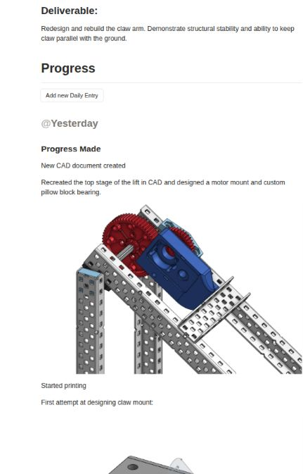
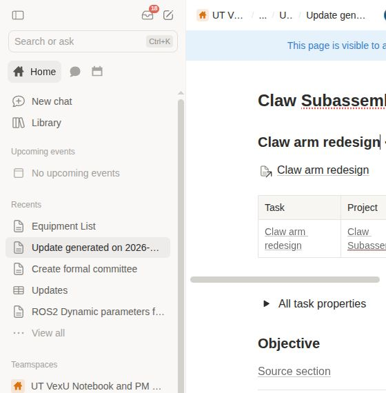

# Notion meeting update extractor

**This is completely vibecoded.** Built with Codex for VEXU GHOST to turn our Notion engineering notebook into a scrollable meeting agenda.

Run it on demand: it reads task updates since the previous Sunday (exclusive), includes newly created tasks, and creates one date/time-stamped page inside the **Updates** database. The CLI prints the new page’s link. Python 3.10+, standard library only; no Notion AI subscription needed.

## How our Notion works

[Project Management](https://www.notion.so/21b96ffbd3f58006a36bedafe856e653) connects projects to the [Tasks table](https://www.notion.so/31b96ffbd3f5804184a8ffc25972881b). Projects belong to subteams; tasks hold assignments, status, objectives, deliverables, and dated progress entries with participants and next steps.

The agenda groups **project subteam → project → task**, keeping every update for a task together and using participant overlap to help meeting flow. New tasks show objectives and deliverables expanded. It reads source Tasks/Projects and **only writes pages, blocks, and properties in [Updates](https://www.notion.so/31bf8116abd845d58650c193ccc25387)**, plus new media attachments.

## Run

```sh
cp .env.example .env
# Fill in NOTION_TOKEN; GHOST database IDs are already provided.
python3 notion_feed.py
```

Give the integration read access to Tasks/Projects and write access to Updates. Use Linux, macOS, or WSL. Runs are manual; nothing is scheduled. The window uses `TIMEZONE` (America/Chicago by default); a Sunday run covers the preceding Monday–Sunday.

```dotenv
NOTION_TOKEN=your_integration_token
NOTION_TASKS_DATABASE_ID=your_tasks_database_id
NOTION_TASKS_DATA_SOURCE_ID=your_tasks_data_source_id
NOTION_PROJECTS_DATA_SOURCE_ID=your_projects_data_source_id
NOTION_UPDATES_DATABASE_ID=your_updates_database_id
NOTION_UPDATES_DATA_SOURCE_ID=your_updates_data_source_id
TIMEZONE=America/Chicago
PROJECT_PROPERTY=Project
UNDATED_YEAR=
```

See [.env.example](.env.example) for the team configuration. Keep `.env` private. Optional local `people_map.json` maps plain-text participant aliases to Notion user IDs; unmapped names remain text.

```sh
python3 notion_feed.py --dry-run    # fresh local preview; no Notion writes
python3 -m unittest -q             # offline tests
```

Formatting and media are preserved where the API supports them; buttons are skipped. Existing suitable synced blocks can stay live; other content is copied as a snapshot. Unsupported blocks and media over 20 MB keep source links. Rerun to pick up changes. [Implementation details](docs/implementation.md).

## Example: Claw arm redesign

[Original task](https://app.notion.com/p/Claw-arm-redesign-3f696ffbd3f5801394f9dd1d6d270e79) and its section in the [October 11 agenda](https://www.notion.so/3f696ffbd3f581e4a020f7ebc75ce8a8). The agenda’s table links back to the task; its updates appear below the shared header.

| Original task update | Generated agenda and task table |
| --- | --- |
|  |  |
